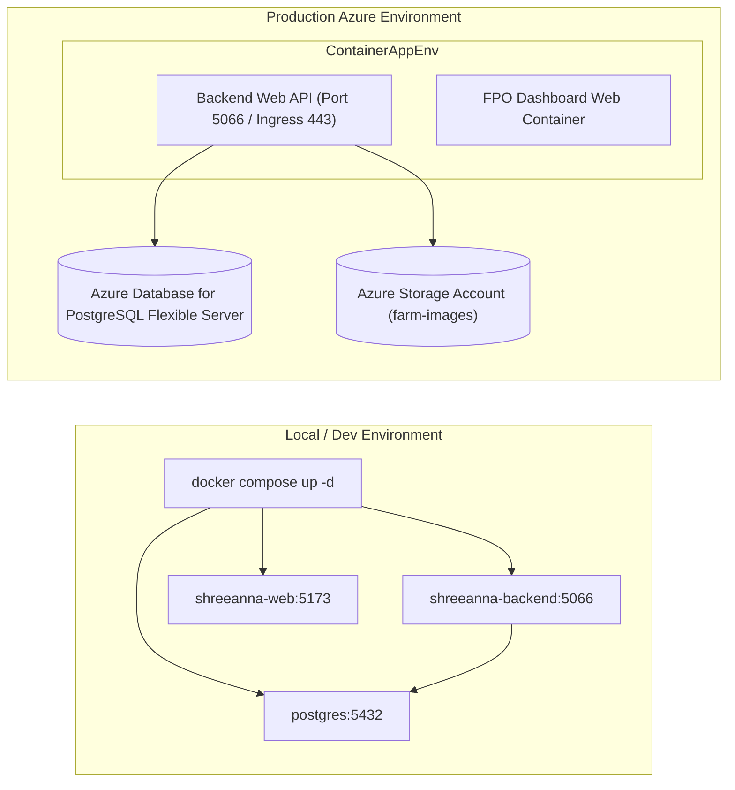

# ShreeAnna — High-Level Architecture (HLD)

> **Document Version:** 1.0.0  
> **Target Platform:** Cloud (Azure Container Apps / Docker Compose)  
> **Last Updated:** October 2026  
> **Classification:** Technical System Architecture Documentation  

---

## 1. Executive Summary & System Vision

**ShreeAnna** is an end-to-end digital procurement, traceability, logistics, quality certification, and financial settlement platform designed for the Millet Value Chain. The platform connects smallholder millet farmers, Farmer Producer Organizations (FPOs), third-party logistics (drivers), certified quality inspectors, warehouse managers, and institutional buyers/processors.

The system ensures complete transparency, eliminating intermediaries and guaranteeing verifiable quality and fair pricing from farm gate to warehouse ingestion and settlement.

```
+----------------------------------------------------------------------------------------------------+
|                                    SHREEANNA PLATFORM ECOSYSTEM                                    |
+------------------------------------+----------------------------------+----------------------------+
|        Mobile (Flutter 3.x)        |     Web Dashboard (React 19)     |    Backend (.NET 10 API)   |
|   - Farmers (Onboarding, Lots)     |   - FPO Administrators           |   - Clean Architecture     |
|   - Drivers (GPS, Deliveries)      |   - Quality Inspectors           |   - PostgreSQL + EF Core   |
|   - Offline-tolerant HTTP sync     |   - Warehouse & Finance Staff    |   - Azure Blob SAS Engine  |
+------------------------------------+----------------------------------+----------------------------+
```

---

## 2. Global System Context Diagram

The following Mermaid diagram illustrates the global architecture across client interfaces, API boundaries, background workers, databases, and third-party SaaS providers:

```mermaid

graph TB
    subgraph Clients["Client Tier"]
        FarmerApp["Farmer Mobile App<br/>(Flutter / Android / iOS / Inspector Chat)"]
        DriverApp["Driver Mobile App<br/>(Flutter / GPS Tracking)"]
        WebPortal["FPO Management Portal & Support Desk<br/>(React 19 + Vite + Tailwind + shadcn/ui)"]
        CustomerMarketplace["Customer Marketplace & Cart<br/>(Public Catalog & Order Portal)"]
        PublicVerifier["Public QR Certificate Verifier<br/>(Web / Mobile Browser)"]
    end

    subgraph SecurityBoundary["Security & Gateway Perimeter"]
        ReverseProxy["Reverse Proxy / TLS Termination<br/>(HTTPS 443 / Nginx / Azure Envoy)"]
        AuthFilter["JWT Bearer Authentication<br/>& Role-Based Authorization Policy"]
        CorsEngine["CORS Policy Engine<br/>(_myAllowSpecificOrigins)"]
        OpenApiSwagger["OpenAPI / Swagger Engine<br/>(Unique CustomSchemaIds)"]
    end

    subgraph ApplicationTier["Application Tier (.NET 10 Web API)"]
        AuthModule["Auth & Identity Service<br/>(JWT, OTP, Customer Register)"]
        FarmerModule["Farmer & Farm Registry<br/>(Geo-Tagging, Verification)"]
        ProcurementModule["Procurement & Lot Engine<br/>(Lots, Agreements, Pricing)"]
        QualityModule["Quality & Inspection Engine<br/>(Specs, QR Certificates)"]
        LogisticsModule["Logistics & Dispatch Service<br/>(GPS Logs, Verification OTP)"]
        WarehouseModule["Warehouse & Inventory Service<br/>(Batches, Stock Movements)"]
        SettlementModule["Settlement & Payment Engine<br/>(Razorpay Links, Ledger)"]
        ReportsModule["Reports & Analytics Aggregator<br/>(Live Margins, Revenue, Volume)"]
        MarketplaceOrdersModule["Marketplace & Orders Service<br/>(Catalog, Cart, Driver Assign, Delivery OTP)"]
        
        subgraph ActorEngine["Akka.NET Actor Subsystem"]
            ChatManagerActor["ChatManagerActor<br/>(Session Coordinator & Presence)"]
            UserSessionActor["UserSessionActor<br/>(Per-User Queue & Fault Isolation)"]
        end
    end

    subgraph PersistenceTier["Persistence & Storage Tier"]
        PostgresDB[("PostgreSQL 16+<br/>(Neon / Azure PG / Local)<br/>AppDbContext + EF Core")]
        AzureBlob[("Azure Blob Storage<br/>(Container: farm-images)<br/>Direct SAS Writes")]
    end

    subgraph ExternalServices["External Services & Gateways"]
        SendOTP["MSG91 SendOTP Service<br/>(SMS Gateway / OTP Fallback)"]
        Razorpay["Razorpay Gateway<br/>(Mock / Live API Links)"]
        CartoMaps["CARTO & OSM Maps<br/>(Tile & Routing Services)"]
        FCM["Firebase Cloud Messaging<br/>(Push Notifications)"]
    end

    subgraph MemoryEngine["AI Memory & Knowledge Graph"]
        GraphifyGraph[("Graphify AST Engine<br/>(graphify-out/graph.json)<br/>AST Knowledge & Code Intelligence")]
    end

    %% Client Connections
    FarmerApp -->|REST / HTTPS| ReverseProxy
    DriverApp -->|REST / HTTPS / GPS Telemetry| ReverseProxy
    WebPortal -->|REST / HTTPS / In-Memory JWT| ReverseProxy
    PublicVerifier -->|Public GET / REST| ReverseProxy

    ReverseProxy --> CorsEngine
    CorsEngine --> AuthFilter
    AuthFilter --> ApplicationTier

    %% Application Tier to Data Tier
    ApplicationTier -->|Npgsql / EF Core| PostgresDB
    ApplicationTier -->|Azure.Storage.Blobs / SAS Generation| AzureBlob
    FarmerApp -.->|Direct Image Upload via Signed SAS| AzureBlob
    WebPortal -.->|Direct Image Upload via Signed SAS| AzureBlob

    %% External Gateway Integrations
    AuthModule -->|REST API| SendOTP
    SettlementModule -->|Payment Links / Webhooks| Razorpay
    DriverApp -->|Tiles / GeoJSON| CartoMaps
    ApplicationTier -->|HTTP v1 API| FCM

    %% Graphify
    ApplicationTier -.->|Indexed by AST| GraphifyGraph
```



---

## 3. Subsystem Breakdown

### 3.1 Mobile Frontend (Flutter 3.x)
- **Target Platforms:** Android (minSdkVersion 21, targetSdkVersion 34), iOS (14+), Linux/Windows desktop for local dev.
- **Architectural Pattern:** Feature-First Clean Architecture (`features/{auth, farm, lots, driver, profile, support}`).
- **Key Capabilities:**
  - Dynamic user-role entry routing: Unauthenticated (`WelcomeScreen`), Driver (`DriverJourneyScreen`), Farmer (`HomeScreen`).
  - Network Resilience: `ApiClient` automatically detects Android Emulator loopback (`10.0.2.2`) and seamlessly fails over to localhost (`127.0.0.1`) and production Azure endpoint.
  - Multi-language Localization (l10n): English (`en`), Hindi (`hi`), and Gujarati (`gu`) with hot language switching via `AppLanguage`.
  - 1-to-1 Inspector Chat: Direct real-time support chat between farmer and assigned Quality Inspector (`InspectorChatScreen`) scoped to lot inspection stage.
  - Native Integrations: Geolocator for GPS boundary tagging and live driver telemetry; Image Picker with Azure SAS direct upload; MSG91 SendOTP SDK.

### 3.2 Web Frontend (React 19 + Vite)
- **Framework & Tooling:** React 19, Vite, Tailwind CSS, shadcn/ui component primitives, Lucide React icons, Recharts visualization.
- **Architectural Pattern:** Modular feature-driven directory structure (`features/{auth, farmers, procurement, quality, logistics, warehouse, inventory, settlements, reports, buyers, fpo, portal}`).
- **Key Capabilities:**
  - Zero-CSRF In-Memory Token Architecture: Access tokens are held strictly in JavaScript memory closure; refresh tokens are exchanged via HttpOnly cookies with `credentials: "include"`.
  - Automatic 401 Interception: Transparent token refresh with single-retry execution before redirecting to login.
  - WhatsApp-Style Support Desk (`Support.jsx`): Two-pane live chat desk for Quality Inspectors and staff with active conversation queues, unread badges, and auto-scrolling message streams.
  - Universal Settings & Profile: Dedicated Settings, Profile, and Support pages available across all system roles.
  - Customer Marketplace & Cart: Public e-commerce catalog, direct "Buy" to slide-out drawer cart, frictionless checkout, and dedicated customer order history.
  - Comprehensive FPO Portals: Farm land boundary verification, quality test assessment, lot allocation, driver dispatch management, Razorpay payment processing, and interactive financial reporting.

### 3.3 Backend API (.NET 10 Web API)
- **Framework & Runtime:** ASP.NET Core 10 on .NET 10, C# 13.
- **Architectural Pattern:** Feature-Sliced Clean Architecture (`Features/<Domain>/{Controllers, Services, DTOs, Entities}`).
- **Key Capabilities:**
  - Akka.NET Actor Engine: In-memory actor model (`UserSessionActor`, `ChatManagerActor`) delivering lightweight per-user processes, ephemeral message buffering, and complete fault isolation for live support chat.
  - OpenAPI / Swagger Gen Resilience: Configured with `options.CustomSchemaIds(type => type.FullName?.Replace("+", ".") ?? type.Name)`, preventing schema ID collisions across slices.
  - Relational ORM: Entity Framework Core 10 with Npgsql provider and `UtcDateTimeConverter` for UTC standardization.
  - Automatic Migration & Seed: `DbSeeder.SeedAsync()` automatically initializes system roles, test FPO members, warehouses, and seed inventory on startup.
  - Storage Layer Abstraction: `IBlobStorageService` supporting Azure Blob Storage SAS token minting (`upload/sas`) and server-side fallback (`upload`).
  - Mock & Live Payment Gateway: `IRazorpayMockGatewayService` simulating instant merchant settlements, webhook callbacks, and Razorpay payment link generation.
  - Customer Marketplace Engine: Dedicated controllers for catalog (`MarketplaceController`) and orders (`OrdersController`), with 6-digit delivery OTP verification.

---

## 4. Cross-System Boundaries & Protocols

| Boundary Link | Protocol | Payload Format | Authentication / Security Context |
| :--- | :--- | :--- | :--- |
| **Mobile App ↔ .NET Backend** | HTTPS (REST) | JSON / UTF-8 | JWT Bearer in `Authorization` header (`Bearer <token>`) |
| **Mobile App ↔ Support Chat** | HTTPS (REST / Polling) | JSON / UTF-8 | JWT Bearer (`/api/support/chat/*`) |
| **Mobile App ↔ Azure Blob** | HTTPS (PUT) | Binary Image (`image/jpeg`, `image/png`) | Signed SAS Query Token (`?sv=...&sig=...&sp=w`) |
| **Mobile App ↔ MSG91 SDK** | HTTPS (REST) | JSON | `SENDOTP_AUTH_TOKEN` & `SENDOTP_WIDGET_ID` |
| **React Web ↔ .NET Backend** | HTTPS (REST) | JSON / UTF-8 | In-Memory JWT Bearer + HttpOnly Refresh Cookie |
| **Web Support Desk ↔ Akka Backend** | HTTPS (REST / Polling) | JSON / UTF-8 | In-Memory JWT Bearer (`/api/support/chat/*`) |
| **React Web ↔ Azure Blob** | HTTPS (PUT) | Binary Image / PDF | Signed SAS Query Token with `x-ms-blob-type: BlockBlob` |
| **.NET Backend ↔ PostgreSQL** | TCP / SSL (5432) | Binary PostgreSQL Protocol | Database Credentials (User, Password, SSL Mode Require) |
| **.NET Backend ↔ Razorpay API** | HTTPS (REST) | JSON | Basic Auth (Key ID : Key Secret) |
| **Driver Telemetry ↔ Backend** | HTTPS (POST) | JSON Batch | JWT Bearer (`lat`, `lng`, `accuracyMeters`, `lotId`) |
| **Customer Orders ↔ Backend** | HTTPS (REST) | JSON | Public & Customer JWT (`/api/orders/*`) |

---

## 5. Security Architecture & Threat Model

```
+----------------------------------------------------------------------------------------------------+
|                                    SECURITY PERIMETER & ISOLATION                                  |
+-----------------------------------+-----------------------------------+----------------------------+
| 1. Identity & Auth               | 2. Data in Transit                | 3. Storage & Secrets       |
| - Stateless JWT (60m expiry)      | - Strict TLS 1.3 encryption       | - Database passwords in    |
| - Refresh token rotation          | - CORS origin whitelisting        |   environment variables    |
| - Scoped Role claims              | - Parameterized SQL queries       | - Azure Blob SAS limited   |
|   (Farmer, Driver, FPO Admin,     |   (EF Core preventing SQLi)       |   to write-only (15 min)   |
|    Inspector, Warehouse, Buyer,   | - In-memory access token on Web   | - Plaintext secrets barred |
|    Customer)                      | - Fault isolation via Akka Actors |                            |
+-----------------------------------+-----------------------------------+----------------------------+
```

### 5.1 Role-Based Access Control (RBAC) Matrix

| User Role | Mobile Access | Web Dashboard Access | Permitted Operations |
| :--- | :---: | :---: | :--- |
| **Farmer** | Yes | No | Profile update, Farm registration, Lot submission, Agreement sign-off, Payment tracking, 1-to-1 Inspector chat. |
| **Driver** | Yes | No | Journey list, Pickup verification code submission, Live GPS broadcasting, Delivery confirmation. |
| **FPO Admin** | No | Yes | Full platform oversight, member management, margin analytics, payment authorization, Support desk. |
| **Quality Inspector** | No | Yes | Inspection assignment, Moisture/impurity scoring, Grade determination, Certificate issuance, WhatsApp-style live chat desk. |
| **Warehouse Manager**| No | Yes | Gate receiving, Scale weight validation, Lot warehouse allocation, Stock movement auditing, Settings & Profile. |
| **Accountant** | No | Yes | Financial dashboard, settlement queue, Razorpay payouts, tax invoice printing, Settings & Profile. |
| **Logistics Coordinator** | No | Yes | Dispatch creation, driver assignment, vehicle monitoring, Settings & Profile. |
| **Customer** | No | Yes | Browse marketplace, add to cart, checkout orders, track delivery status, Settings & Profile. |

---

## 6. Infrastructure & Deployment Topology



- **Containerization:** Multi-stage Dockerfiles for both `.NET 10 Web API` (`backend/Dockerfile`) and `React 19 Vite Web` (`frontend/website/Dockerfile` with Nginx).
- **Orchestration:** `docker-compose.yml` mounts root `.env` variables directly into containers with healthchecks and restart policies.
- **Zero Mock Data Policy:** All endpoints query PostgreSQL directly via EF Core; migrations and schema seeds run automatically on container bootstrap.

---

## 7. AI Memory Engine Integration (Graphify)

The codebase architecture is continuously indexed by **Graphify** (`graphify-out/graph.json`), maintaining an AST graph containing:
- **3,974 nodes** across C#, Dart, JavaScript, and SQL models.
- **6,246 architectural edges** tracking calls, imports, DTO inheritance, and database foreign keys.
- **God Nodes monitored:** `AppDbContext` (79 edges), `Dispatch` (48 edges), `ProcurementLot` (48 edges), `FarmResponse` (43 edges), `SettlementResponse` (43 edges).
- **Workflow Enforcement:** Developers and AI agents query Graphify before refactoring and execute `graphify update .` post-modification to keep the system knowledge base in lockstep with the codebase.
