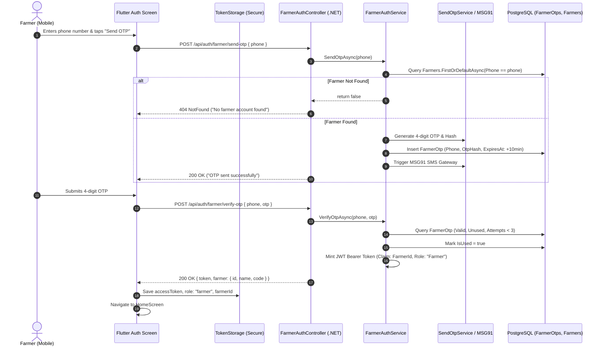
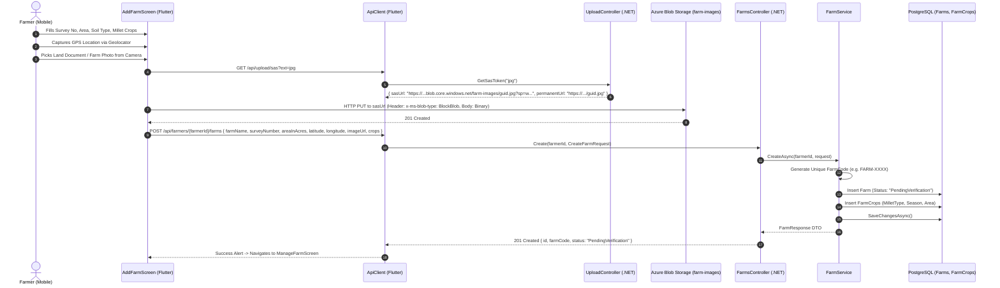
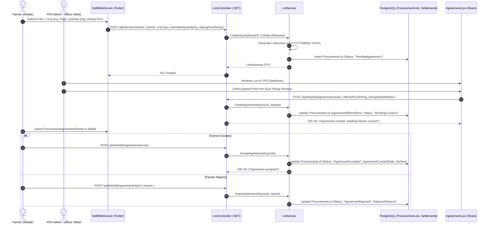
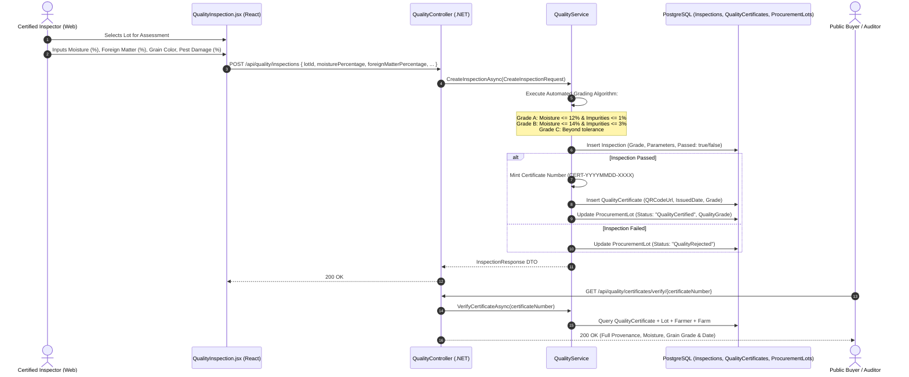
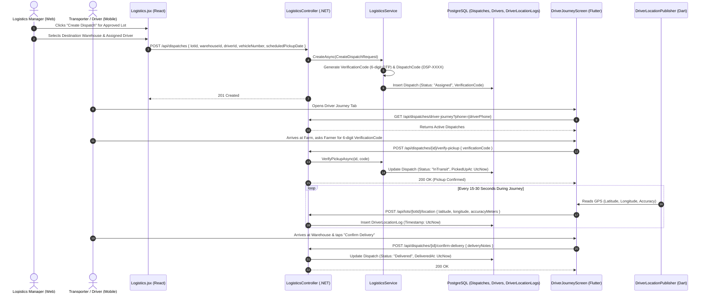
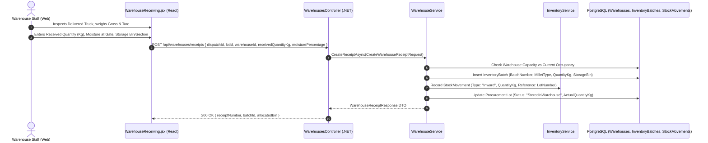
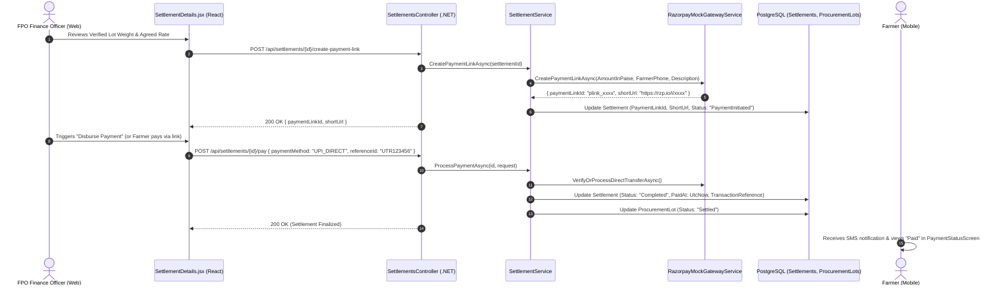

# ShreeAnna — Low-Level Architecture & Data Flow (LLD)

> **Document Version:** 1.0.0  
> **Target Platform:** Cloud / Hybrid (.NET 10 + Flutter + React 19 + PostgreSQL)  
> **Last Updated:** October 2026  
> **Classification:** Technical Low-Level System Specification  

---

## 1. Architectural Patterns & Layering

The ShreeAnna codebase follows a strictly separated **Clean Architecture / Vertical Slice Architecture** across all three platforms:

```
[Flutter Mobile App]                   [React 19 Web Dashboard]
        │                                        │
        ▼ (ApiClient with Fallback)              ▼ (Central api.js + In-Memory Token)
        └─────────────────┬──────────────────────┘
                          │ HTTPS / JSON / Multipart
                          ▼
            [ASP.NET Core 10 Web API]
 ┌─────────────────────────────────────────────────────────┐
 │ Controllers Tier: [ApiController] Attributes            │
 │ Auth & Claims: ClaimsPrincipal / Roles Validation       │
 ├─────────────────────────────────────────────────────────┤
 │ Service Interface Tier: IFarmerService, ILotService... │
 │ Business Logic Tier: Domain Validations, Calculations   │
 ├─────────────────────────────────────────────────────────┤
 │ Data Access Tier: EF Core 10 / AppDbContext             │
 │ Database Provider: Npgsql (PostgreSQL 16+)              │
 ├─────────────────────────────────────────────────────────┤
 │ External Gateways: Azure Blob SAS, Razorpay, MSG91      │
 └─────────────────────────────────────────────────────────┘
```

---

## 2. End-to-End Data Lifecycles

### 2.1 Farmer Authentication & OTP Lifecycle



- **Impacted Files:**
  - Mobile: `frontend/mobile/lib/features/auth/screen/login_screen.dart`, `otp_screen.dart`, `send_otp_service.dart`, `api_client.dart`
  - Backend: `backend/Features/Auth/Controllers/FarmerAuthController.cs`, `FarmerAuthService.cs`, `FarmerOtp.cs`
  - Database: `public."FarmerOtps"`, `public."Farmers"`
- **DTOs & Models:** `SendOtpRequest(Phone)`, `VerifyOtpRequest(Phone, Otp)`, `LoginResponse(Token, Farmer)`

---

### 2.2 Farm Registration, Geo-Tagging & Azure SAS Image Upload



- **Impacted Files:**
  - Mobile: `frontend/mobile/lib/features/farm/screen/add_farm_screen.dart`, `farm_api.dart`, `api_config.dart`
  - Backend: `backend/Features/Farms/Controllers/FarmsController.cs`, `UploadController.cs`, `FarmService.cs`, `AzureBlobStorageService.cs`
  - Database: `public."Farms"`, `public."FarmCrops"`
- **DTOs & Models:** `CreateFarmRequest`, `FarmResponse`, `CreateFarmCropRequest`, `FarmCropResponse`

---

### 2.3 Procurement Lot Creation & FPO Agreement Lifecycle



- **Impacted Files:**
  - Mobile: `frontend/mobile/lib/features/lots/screen/sell_millet_screen.dart`, `procurement_agreement_screen.dart`, `lot_api.dart`
  - Web: `frontend/website/src/features/procurement/pages/Agreements.jsx`, `CreateAgreement.jsx`
  - Backend: `backend/Features/Procurement/Controllers/LotsController.cs`, `LotService.cs`, `ProcurementLot.cs`
  - Database: `public."ProcurementLots"`
- **DTOs & Models:** `CreateLotRequest`, `FormulateAgreementRequest`, `RejectAgreementRequest`, `LotResponse`, `LotTimelineResponse`

---

### 2.4 Quality Inspection & QR Certificate Generation Lifecycle



- **Impacted Files:**
  - Web: `frontend/website/src/features/quality/pages/QualityInspection.jsx`, `QualityManagement.jsx`, `VerifyCertificate.jsx`
  - Mobile: `frontend/mobile/lib/features/lots/screen/quality_results_screen.dart`, `quality_certificate_screen.dart`
  - Backend: `backend/Features/Quality/Controllers/QualityController.cs`, `QualityService.cs`, `Inspection.cs`, `QualityCertificate.cs`
  - Database: `public."Inspections"`, `public."QualityCertificates"`
- **DTOs & Models:** `CreateInspectionRequest`, `InspectionResponse`, `QualityCertificateResponse`

---

### 2.5 Logistics Dispatch, Driver Assignment & Live GPS Telemetry



- **Impacted Files:**
  - Mobile: `frontend/mobile/lib/features/driver/screens/driver_journey_screen.dart`, `driver_location_publisher.dart`, `driver_fullscreen_map_screen.dart`
  - Web: `frontend/website/src/features/logistics/pages/Logistics.jsx`, `CreateShipment.jsx`, `ShipmentDetails.jsx`
  - Backend: `backend/Features/Logistics/Controllers/LogisticsController.cs`, `LogisticsService.cs`, `Dispatch.cs`, `Driver.cs`, `DriverLocationLog.cs`
  - Database: `public."Dispatches"`, `public."Drivers"`, `public."DriverLocationLogs"`
- **DTOs & Models:** `CreateDispatchRequest`, `AssignDriverRequest`, `VerifyPickupRequest`, `RecordDriverLocationRequest`, `DispatchResponse`

---

### 2.6 Warehouse Ingestion, Weighment & Lot Allocation Lifecycle



- **Impacted Files:**
  - Web: `frontend/website/src/features/warehouse/pages/WarehouseReceiving.jsx`, `WarehouseLotAllocation.jsx`, `Warehouses.jsx`
  - Backend: `backend/Features/Warehouses/Controllers/WarehousesController.cs`, `WarehouseService.cs`, `InventoryService.cs`, `Warehouse.cs`, `InventoryBatch.cs`
  - Database: `public."Warehouses"`, `public."InventoryBatches"`, `public."StockMovements"`
- **DTOs & Models:** `CreateWarehouseReceiptRequest`, `WarehouseReceiptResponse`, `AllocateLotRequest`, `LotAllocationResponse`

---

### 2.7 Settlement Generation & Razorpay Payment Lifecycle



- **Impacted Files:**
  - Web: `frontend/website/src/features/settlements/pages/Settlements.jsx`, `SettlementDetails.jsx`
  - Mobile: `frontend/mobile/lib/features/lots/screen/payment_status_screen.dart`
  - Backend: `backend/Features/Settlements/Controllers/SettlementsController.cs`, `SettlementService.cs`, `RazorpayMockGatewayService.cs`, `Settlement.cs`
  - Database: `public."Settlements"`
- **DTOs & Models:** `CreatePaymentLinkResponse`, `ProcessPaymentRequest`, `SettlementResponse`, `SettlementStatsResponse`

---

## 3. Database Schema & Entity Inventory

All tables are defined in PostgreSQL with standard UTC timestamps and decimal precision constraints configured in `backend/Data/AppDbContext.cs`:

| Table Name | Primary Key | Key Foreign Keys | Unique Indexes | Critical Columns |
| :--- | :--- | :--- | :--- | :--- |
| `Users` | `Id (UUID)` | `FpoMemberId (UUID)` | `Email` | `PasswordHash`, `Role`, `RefreshToken`, `RefreshTokenExpiryTime` |
| `FpoMembers` | `Id (UUID)` | — | `EmployeeCode` | `Name`, `Role`, `Designation`, `Phone` |
| `Farmers` | `Id (UUID)` | — | `FarmerCode` | `FullName`, `Phone`, `Taluka`, `Village`, `District`, `Status` |
| `FarmerOtps` | `Id (UUID)` | — | `Phone` | `OtpHash`, `ExpiresAt`, `IsUsed`, `Attempts`, `CreatedAt` |
| `Farms` | `Id (UUID)` | `FarmerId (UUID)` | `FarmCode` | `SurveyNumber`, `AreaInAcres`, `Latitude`, `Longitude`, `ImageUrl`, `Status` |
| `FarmCrops` | `Id (UUID)` | `FarmId (UUID)` | `(FarmId, CropName, Season)` | `CropName`, `Season`, `EstimatedAreaInAcres`, `Status` |
| `ProcurementLots` | `Id (UUID)` | `FarmerId`, `FarmId` | `LotNumber` | `MilletType`, `EstimatedQuantityKg`, `ActualQuantityKg`, `PricePerKg`, `Status` |
| `Inspections` | `Id (UUID)` | `LotId (UUID)` | — | `MoisturePercentage`, `ForeignMatterPercentage`, `Grade`, `Passed` |
| `QualityCertificates`| `Id (UUID)`| `LotId (UUID)` | `CertificateNumber` | `Grade`, `IssuedDate`, `QRCodeUrl`, `InspectorName` |
| `Drivers` | `Id (UUID)` | — | `Phone` | `Name`, `VehicleNumber`, `VehicleCapacityKg`, `LicenseNumber`, `Status` |
| `Dispatches` | `Id (UUID)` | `LotId`, `DriverId`, `WarehouseId` | `DispatchCode` | `VerificationCode`, `Status`, `ScheduledPickupDate`, `DeliveredAt` |
| `DriverLocationLogs` | `Id (UUID)` | `LotId (UUID)` | — | `Latitude`, `Longitude`, `AccuracyMeters`, `Timestamp` |
| `Warehouses` | `Id (UUID)` | — | `WarehouseCode`| `Name`, `CapacityKg`, `CurrentOccupancyKg`, `District`, `Pincode` |
| `InventoryBatches` | `Id (UUID)` | `WarehouseId`, `LotId`| `BatchNumber` | `MilletType`, `QuantityKg`, `StorageBin`, `QualityGrade` |
| `StockMovements` | `Id (UUID)` | `WarehouseId`, `BatchId`| — | `MovementType (Inward/Outward)`, `QuantityKg`, `Timestamp` |
| `Settlements` | `Id (UUID)` | `LotId`, `FarmerId` | `SettlementNumber` | `TotalAmount`, `FpoMarginAmount`, `NetPayableToFarmer`, `Status`, `ShortUrl` |
| `PurchaseRequests`| `Id (UUID)` | `BuyerId`, `LotId` | `RequestCode` | `RequestedQuantityKg`, `OfferedPricePerKg`, `Status` |

---

## 4. API Endpoints Comprehensive Registry

| HTTP Verb | Route | Auth Role | Controller | Primary DTOs |
| :--- | :--- | :--- | :--- | :--- |
| `POST` | `/api/auth/login` | Anonymous | `AuthController` | `LoginRequest` → `LoginResponse` |
| `POST` | `/api/auth/refresh` | Anonymous (Cookie) | `AuthController` | None → `LoginResponse` |
| `POST` | `/api/auth/farmer/send-otp` | Anonymous | `FarmerAuthController` | `SendOtpRequest` → Status |
| `POST` | `/api/auth/farmer/verify-otp` | Anonymous | `FarmerAuthController` | `VerifyOtpRequest` → `LoginResponse` |
| `GET` | `/api/farmers` | Authorized | `FarmersController` | None → `List<FarmerResponse>` |
| `POST` | `/api/farmers` | Authorized | `FarmersController` | `CreateFarmerRequest` → `FarmerResponse` |
| `GET` | `/api/upload/sas` | Authorized | `UploadController` | `?ext=jpg` → `{ sasUrl, permanentUrl }` |
| `POST` | `/api/upload` | Authorized | `UploadController` | Multipart `file` → `{ url }` |
| `GET` | `/api/lots` | Anonymous / Auth | `LotsController` | None → `List<LotResponse>` |
| `POST` | `/api/farmers/me/lots` | Farmer | `LotsController` | `CreateLotRequest` → `LotResponse` |
| `POST` | `/api/lots/{id}/agreement/create` | FPO Officer | `LotsController` | `FormulateAgreementRequest` → Status |
| `POST` | `/api/lots/{id}/agreement/accept` | Farmer | `LotsController` | None → Status |
| `POST` | `/api/lots/{id}/agreement/reject` | Farmer | `LotsController` | `RejectAgreementRequest` → Status |
| `POST` | `/api/quality/inspections` | QualityInspector | `QualityController` | `CreateInspectionRequest` → `InspectionResponse` |
| `GET` | `/api/quality/certificates/verify/{no}` | Anonymous | `QualityController` | None → `QualityCertificateResponse` |
| `POST` | `/api/dispatches` | FPO Officer | `LogisticsController` | `CreateDispatchRequest` → `DispatchResponse` |
| `POST` | `/api/dispatches/{id}/verify-pickup`| Driver / Anonymous| `LogisticsController`| `VerifyPickupRequest` → `DispatchResponse` |
| `POST` | `/api/lots/{lotId}/location` | Driver | `LotsController` | `RecordDriverLocationRequest` → Status |
| `POST` | `/api/warehouses/receipts` | WarehouseManager | `WarehousesController` | `CreateWarehouseReceiptRequest` → Response |
| `POST` | `/api/settlements/{id}/create-payment-link` | FPO / Accountant | `SettlementsController` | None → `CreatePaymentLinkResponse` |
| `POST` | `/api/settlements/{id}/pay` | FPO / Accountant | `SettlementsController` | `ProcessPaymentRequest` → `SettlementResponse` |
| `GET` | `/api/reports/summary` | Authorized | `ReportsController` | None → `ReportsSummaryResponse` |
| `GET` | `/api/reports/margin` | Authorized | `ReportsController` | None → `FpoMarginReportResponse` |
