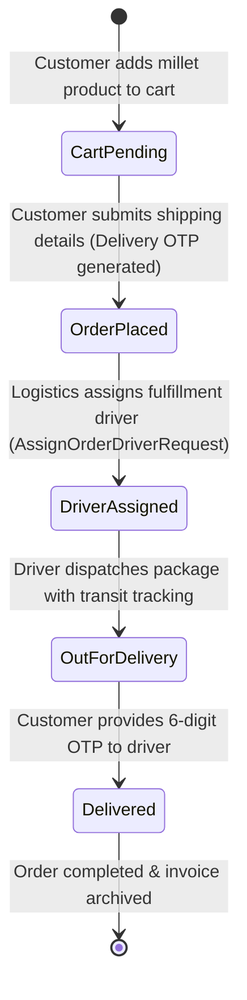

# ShreeAnna — Data Flow Specifications (DFS)

> **Document Version:** 1.0.0  
> **Target Audience:** Backend Developers, Mobile Engineers, Web Developers, System Architects  
> **Last Updated:** October 2026  
> **Classification:** Technical Data Flow Mapping & Reference  

---

## 1. Global Data Flow Summary Table

| Workflow Step | Source Platform | Intermediary Transport | Destination Component | Entity & Schema Impacted |
| :--- | :--- | :--- | :--- | :--- |
| **1. Farmer Login** | Flutter Mobile | HTTPS POST `/api/auth/farmer/send-otp` | `FarmerAuthController` → `FarmerAuthService` | `FarmerOtps` table |
| **2. OTP Verification** | Flutter Mobile | HTTPS POST `/api/auth/farmer/verify-otp` | `FarmerAuthController` → JWT Engine | `FarmerOtps`, `Farmers` |
| **3. Farm Registration**| Flutter Mobile | HTTPS POST `/api/farmers/{id}/farms` | `FarmsController` → `FarmService` | `Farms`, `FarmCrops` |
| **4. Land Image SAS** | Flutter Mobile | HTTPS GET `/api/upload/sas` + Direct PUT | Azure Blob Storage `farm-images` | Azure Block Blob |
| **5. Lot Submission** | Flutter Mobile | HTTPS POST `/api/farmers/me/lots` | `LotsController` → `LotService` | `ProcurementLots` |
| **6. Agreement Creation**| React Web | HTTPS POST `/api/lots/{id}/agreement/create`| `LotsController` → `LotService` | `ProcurementLots` |
| **7. Agreement Consent**| Flutter Mobile | HTTPS POST `/api/lots/{id}/agreement/accept`| `LotsController` → `LotService` | `ProcurementLots` |
| **8. Quality Inspection**| React Web | HTTPS POST `/api/quality/inspections` | `QualityController` → `QualityService` | `Inspections`, `QualityCertificates` |
| **9. Dispatch Creation** | React Web | HTTPS POST `/api/dispatches` | `LogisticsController` → `LogisticsService` | `Dispatches` |
| **10. Pickup OTP** | Flutter Driver | HTTPS POST `/api/dispatches/{id}/verify-pickup`| `LogisticsController` → Verification | `Dispatches` |
| **11. GPS Telemetry** | Flutter Driver | HTTPS POST `/api/lots/{id}/location` | `LotsController` → `DriverLocationLog` | `DriverLocationLogs` |
| **12. Warehouse Gate** | React Web | HTTPS POST `/api/warehouses/receipts` | `WarehousesController` → `WarehouseService` | `InventoryBatches`, `StockMovements` |
| **13. Payment Link** | React Web | HTTPS POST `/api/settlements/{id}/create-payment-link`| `SettlementsController` → `RazorpayMock` | `Settlements` |
| **14. Payment Process** | React Web | HTTPS POST `/api/settlements/{id}/pay` | `SettlementsController` → `SettlementService` | `Settlements`, `ProcurementLots` |
| **15. BI Analytics** | React Web | HTTPS GET `/api/reports/summary` | `ReportsController` → `ReportsService` | Multi-table Read Aggregation |
| **16. Support Chat Connect** | Flutter / React Web | HTTPS POST `/api/support/chat/connect` | `SupportChatController` → `ChatManagerActor` | Akka `UserSessionActor` in-memory |
| **17. 1-to-1 Live Support Chat** | Flutter / React Web | HTTPS POST `/api/support/chat/send` | `SupportChatController` → Akka Message Router | Akka Actor Session Queue |
| **18. Support Desk Web Stream** | React Web | HTTPS GET `/api/support/chat/sessions/active` | `SupportChatController` → `SupportChatService` | Akka Session Summaries |
| **19. Customer Order Placement**| React Web | HTTPS POST `/api/orders` | `OrdersController` → `OrderService` | `Orders`, `OrderItems` |
| **20. Order Driver Allocation** | React Web | HTTPS POST `/api/orders/{id}/assign-driver` | `OrdersController` → `OrderService` | `Orders` (Driver & Shipped) |
| **21. Customer Delivery OTP** | Delivery Driver / Web | HTTPS POST `/api/orders/{id}/confirm-delivery` | `OrdersController` → `OrderService` | `Orders` (Marked Delivered) |

---

## 2. Cross-Subsystem State Machine Mapping

### 2.1 Procurement & Grain Provenance State Machine

```mermaid
stateDiagram-v2
    [*] --> FarmRegistered : Farmer submits farm boundary
    FarmRegistered --> FarmVerified : FPO officer validates cadastral survey
    FarmVerified --> LotCreated : Farmer initiates sale of harvest
    LotCreated --> AgreementDrafted : FPO officer inputs price offer
    AgreementDrafted --> AgreementSigned : Farmer accepts agreement terms in app
    AgreementSigned --> QualityInspected : Quality Inspector grades grain (Chat support active)
    QualityInspected --> DispatchAssigned : Logistics manager assigns vehicle & driver
    DispatchAssigned --> GoodsPickedUp : Driver enters farmer 6-digit verification code
    GoodsPickedUp --> InTransit : Driver broadcasts live GPS telemetry
    InTransit --> WarehouseReceived : Warehouse weighbridge verifies gross/tare weight
    WarehouseReceived --> InventoryBatched : Grain allocated to storage silo/bin
    InventoryBatched --> SettlementGenerated : Price calculation & FPO margin applied
    SettlementGenerated --> PaymentDisbursed : Razorpay link or direct bank transfer executed
    PaymentDisbursed --> [*] : Complete immutable provenance recorded
```

### 2.2 Customer E-Commerce Order Lifecycle

For deeper architectural context and sequence diagrams, refer to:
- [High-Level Architecture (`docs/ARCHITECTURE_HL.md`)](file:///home/bun/clone/ShreeAnna/docs/ARCHITECTURE_HL.md)
- [Low-Level Architecture (`docs/ARCHITECTURE_LL.md`)](file:///home/bun/clone/ShreeAnna/docs/ARCHITECTURE_LL.md)
- [Features Operational Guide (`docs/FEATURES_GUIDE.md`)](file:///home/bun/clone/ShreeAnna/docs/FEATURES_GUIDE.md)
