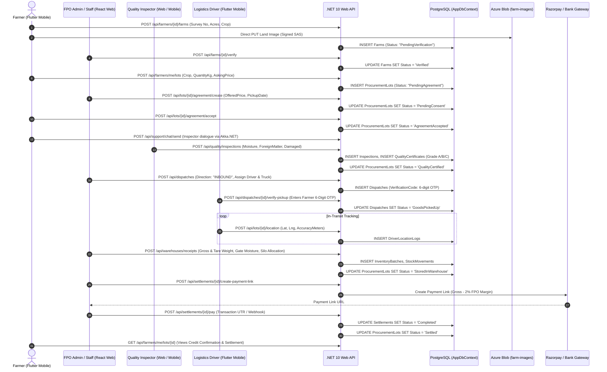
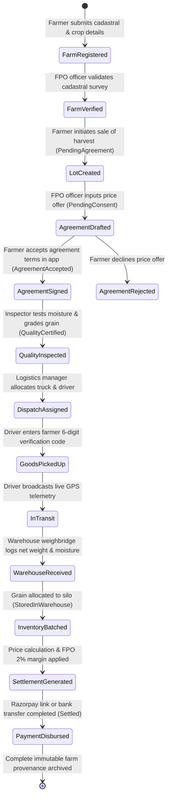
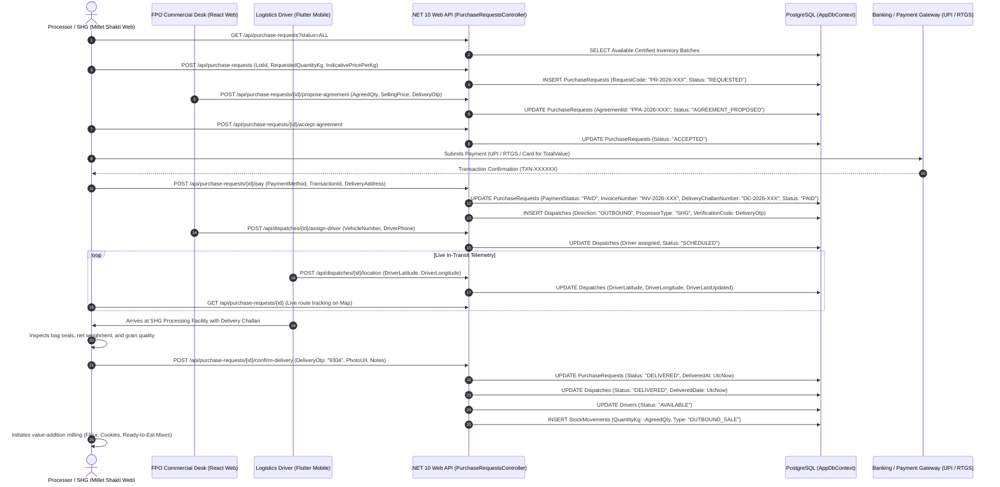
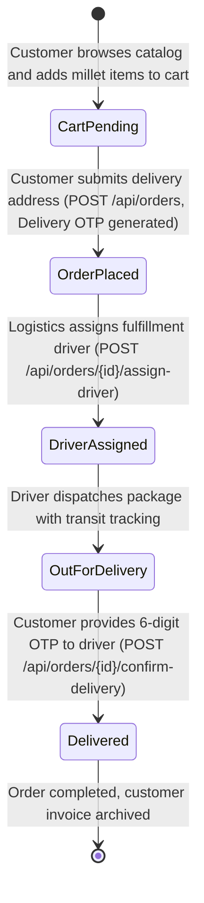

# ShreeAnna — Data Flow Specifications (DFS)

> **Document Version:** 2.0.0  
> **Target Audience:** Backend Developers, Mobile Engineers, Web Developers, System Architects  
> **Last Updated:** October 2026  
> **Classification:** Technical Data Flow Mapping & Reference  

---

## 1. Executive Summary & Dual Value-Chain Architecture

The **ShreeAnna** platform operates as a two-sided digital agritech ecosystem bridging smallholder millet farmers, Farmer Producer Organizations (FPOs), commercial food processors / Self-Help Groups (SHGs), and end consumers. 

The core operational model is divided into two distinct, interconnected data flow pipelines:

```mermaid
flowchart LR
    subgraph UpstreamPipeline["1. UPSTREAM INBOUND DATA FLOW (Farmer ⟷ FPO)"]
        direction TB
        Farmer["Farmer<br/>(Flutter Mobile)"] -->|1. Farm & Lot Submission| FPO_Proc["FPO Procurement Desk<br/>(React Web)"]
        FPO_Proc -->|2. Agreement Terms & Pricing| Farmer
        Inspector["Quality Inspector<br/>(Mobile & Web Portal)"] -->|3. On-Site Moisture/Purity Grade| FPO_Proc
        Driver_In["Logistics Driver<br/>(6-Digit Pickup OTP)|"] -->|4. Farm-Gate Inbound Dispatch| Warehouse["FPO Central Warehouse<br/>(Weighbridge & Silo Batches)"]
        Warehouse -->|5. Financial Settlement & Razorpay| Farmer
    end

    subgraph CentralStorage["CENTRAL REPOSITORY & INVENTORY"]
        Warehouse -->|Certified Grain Batches<br/>public.InventoryBatches| StockCatalog["Available Certified Stock<br/>(Millet Catalog)"]
    end

    subgraph DownstreamPipeline["2. DOWNSTREAM OUTBOUND DATA FLOW (FPO ⟷ Processor / SHG)"]
        direction TB
        StockCatalog -->|1. Available Lot Discovery| SHG["Processor / SHG<br/>(Millet Shakti SHG Web)"]
        SHG -->|2. Submit Purchase Request (PR)| FPO_Sales["FPO Commercial Desk<br/>(React Web)"]
        FPO_Sales -->|3. Propose Agreement (PPA)| SHG
        SHG -->|4. Accept Terms & Advance Payment| Bank["Banking / UPI Gateway<br/>(Tax Invoice & Challan)"]
        Bank -->|5. Scheduled Outbound Dispatch| Driver_Out["Logistics Driver<br/>(Outbound Delivery)"]
        Driver_Out -->|6. 6-Digit Delivery OTP Handshake| SHG
        SHG -->|7. Value Addition & Milling| Products["Finished Goods<br/>(Flour, Cookies, Mixes)"]
    end
```

---

## 2. Data Flow 1: Farmer with FPO (Upstream Inbound Procurement)

### 2.1 Inbound Data Flow Specification Table

| Step # | Stage | Source Platform | Intermediary Transport | Destination Component | Entity & Schema Impacted | Key Payload & Business Rules |
| :---: | :--- | :--- | :--- | :--- | :--- | :--- |
| **1.1** | **Farmer Authentication** | Flutter Mobile | HTTPS POST `/api/auth/farmer/send-otp` | `FarmerAuthController` → `FarmerAuthService` | `FarmerOtps` table | 10-digit mobile number; MSG91 SMS gateway fallback to internal hash. |
| **1.2** | **OTP Verification & JWT** | Flutter Mobile | HTTPS POST `/api/auth/farmer/verify-otp` | `FarmerAuthController` → JWT Engine | `FarmerOtps`, `Farmers` | 4-digit OTP validated within 10-minute expiry; scoped JWT issued. |
| **1.3** | **Farm Registration** | Flutter Mobile | HTTPS POST `/api/farmers/{id}/farms` | `FarmsController` → `FarmService` | `Farms`, `FarmCrops` | Captures Survey No., Area in Acres, Soil Type, GPS Lat/Lng, Millet crop name. Status: `PendingVerification`. |
| **1.4** | **Land Document Image SAS**| Flutter Mobile | HTTPS GET `/api/upload/sas` + Direct PUT | Azure Blob Storage `farm-images` | Azure Block Blob Storage | Direct-to-cloud signed SAS URL writes bypassing backend server memory. |
| **1.5** | **Farm Cadastral Verification**| React Web Portal | HTTPS POST `/api/farms/{id}/verify` | `FarmsController` → `FarmService` | `Farms` | FPO officer validates survey record; updates status to `Verified`. |
| **1.6** | **Lot Submission** | Flutter Mobile | HTTPS POST `/api/farmers/me/lots` | `LotsController` → `LotService` | `ProcurementLots` | Farmer inputs crop, estimated quantity (Kg), expected price/Kg. Status: `PendingAgreement`. |
| **1.7** | **Agreement Proposal** | React Web Portal | HTTPS POST `/api/lots/{id}/agreement/create` | `LotsController` → `LotService` | `ProcurementLots` | FPO officer evaluates market price; offers price/Kg, pickup window, and warehouse. Status: `PendingConsent`. |
| **1.8** | **Digital Consent** | Flutter Mobile | HTTPS POST `/api/lots/{id}/agreement/accept` | `LotsController` → `LotService` | `ProcurementLots` | Farmer accepts procurement terms digitally. Status: `AgreementAccepted`. |
| **1.9** | **Live Inspector Chat** | Flutter / Web | HTTPS POST `/api/support/chat/send` | `SupportChatController` → Akka.NET | Akka Actor Session Queue | Contextual 1-to-1 dialogue between Farmer and assigned Quality Inspector. |
| **1.10** | **Quality Inspection** | React Web / Mobile | HTTPS POST `/api/quality/inspections` | `QualityController` → `QualityService` | `Inspections`, `QualityCertificates` | Moisture ($\le 12\%$), impurities ($\le 1\%$), damaged ($\le 2\%$). Issues Grade A/B/C and `CERT-YYYYMMDD-XXXX`. Status: `QualityCertified`. |
| **1.11** | **Inbound Dispatch Scheduling**| React Web Portal | HTTPS POST `/api/dispatches` | `LogisticsController` → `LogisticsService` | `Dispatches` | Vehicle and driver assigned; `Direction = "INBOUND"`. Generates secure 6-digit pickup verification code on farmer app. |
| **1.12** | **Farm-Gate Pickup OTP** | Flutter Driver App | HTTPS POST `/api/dispatches/{id}/verify-pickup` | `LogisticsController` → Verification | `Dispatches` | Driver inputs farmer's 6-digit code on-site. Status: `GoodsPickedUp`. |
| **1.13** | **Live GPS Telemetry** | Flutter Driver App | HTTPS POST `/api/lots/{id}/location` | `LotsController` → `DriverLocationLog` | `DriverLocationLogs` | Continuous transit telemetry filtered for `AccuracyMeters <= 50`. Status: `InTransit`. |
| **1.14** | **Warehouse Weighment & Silo** | React Web Portal | HTTPS POST `/api/warehouses/receipts` | `WarehousesController` → `WarehouseService` | `InventoryBatches`, `StockMovements` | Gross minus Tare weight determines net weight; gate moisture checked; allocated to Silo/Bin. Status: `StoredInWarehouse`. |
| **1.15** | **Settlement Generation** | React Web Portal | HTTPS POST `/api/settlements/{id}/create-payment-link` | `SettlementsController` → `RazorpayMock` | `Settlements` | Gross = Qty $\times$ Agreed Price. Net = Gross $-$ FPO Margin (2%). Payment link minted. |
| **1.16** | **Disbursement Confirmation** | React Web Portal | HTTPS POST `/api/settlements/{id}/pay` | `SettlementsController` → `SettlementService` | `Settlements`, `ProcurementLots` | Payment marked `Completed`; transaction ID saved; immutable provenance closed. Status: `Settled`. |

---

### 2.2 Sequence Diagram: Farmer ⟷ FPO Upstream Flow



---

### 2.3 State Machine: Upstream Inbound Lifecycle



---

## 3. Data Flow 2: FPO with Processor / SHG (Downstream Commercial Supply & Processing)

### 3.1 Outbound Data Flow Specification Table

| Step # | Stage | Source Platform | Intermediary Transport | Destination Component | Entity & Schema Impacted | Key Payload & Business Rules |
| :---: | :--- | :--- | :--- | :--- | :--- | :--- |
| **2.1** | **Stock Catalog Discovery** | Processor Web Portal | HTTPS GET `/api/purchase-requests` / `/api/warehouses/stock` | `PurchaseRequestsController` → `PurchaseRequestService` | `InventoryBatches`, `PurchaseRequests` | SHG views certified millet inventory batches (`Status = "StoredInWarehouse"`). |
| **2.2** | **Purchase Request (PR)** | Processor Web Portal (`/available-lots`) | HTTPS POST `/api/purchase-requests` | `PurchaseRequestsController` → `PurchaseRequestService` | `PurchaseRequests` | Submits `LotId`, `MilletType`, `RequestedQuantityKg`, `IndicativePricePerKg`. Mints `RequestCode = "PR-2026-XXX"`, Status: `REQUESTED`. |
| **2.3** | **Agreement Proposal (PPA)**| FPO Commercial Desk (`/purchase-requests`) | HTTPS POST `/api/purchase-requests/{id}/propose-agreement` | `PurchaseRequestsController` → `PurchaseRequestService` | `PurchaseRequests` | FPO defines `AgreedQuantityKg`, `SellingPricePerKg`, `TotalValue`, `PaymentTerms` ("100% advance"), `DeliveryOtp` ("9304"), and validity. Status: `AGREEMENT_PROPOSED`. |
| **2.4** | **Agreement Acceptance** | Processor Dashboard (`ProcessorDashboard.jsx`) | HTTPS POST `/api/purchase-requests/{id}/accept-agreement` | `PurchaseRequestsController` → `PurchaseRequestService` | `PurchaseRequests` | Processor/SHG officer accepts commercial agreement terms digitally. Status: `ACCEPTED`. |
| **2.5** | **Advance Commercial Payment**| Processor Portal (`/purchase-payment`) | HTTPS POST `/api/purchase-requests/{id}/pay` | `PurchaseRequestsController` → `PurchaseRequestService` | `PurchaseRequests`, `Dispatches` | Payment via UPI/RTGS/Card. Generates `InvoiceNumber = "INV-2026-XXX"` and `DeliveryChallanNumber = "DC-2026-XXX"`. Auto-schedules outbound `Dispatch` (`Direction = "OUTBOUND"`, `ProcessorType = "SHG"`). Status: `PAID`. |
| **2.6** | **Outbound Driver Assignment**| FPO Logistics Desk (`/logistics`) | HTTPS POST `/api/dispatches/{id}/assign-driver` | `LogisticsController` → `LogisticsService` | `Dispatches`, `Drivers` | Assigns dedicated vehicle and driver. Transporter receives destination address, delivery challan, and scheduled window. |
| **2.7** | **Outbound Transit Telemetry** | Flutter Driver App / GPS | HTTPS POST `/api/dispatches/{id}/location` | `LogisticsController` → `Dispatch` | `Dispatches` | Vehicle departs FPO central warehouse for SHG facility; real-time latitude/longitude coordinates tracked on live map. |
| **2.8** | **SHG Delivery Handshake & OTP**| Processor Portal (`/processor-dashboard`) | HTTPS POST `/api/purchase-requests/{id}/confirm-delivery` | `PurchaseRequestsController` → `PurchaseRequestService` | `PurchaseRequests`, `Dispatches`, `Drivers` | SHG inspects consignment, verifies 4-digit/6-digit `DeliveryOtp` ("9304"), submits delivery proof photo and inspection notes. Status: `DELIVERED`. Driver status reset to `AVAILABLE`. |
| **2.9** | **Inventory Deduction & Milling**| Central Warehouse / SHG | EF Core Transaction | `WarehouseService` → `StockMovements` | `InventoryBatches`, `StockMovements` | Warehouse stock deducted via `OUTBOUND` stock movement. Consignment enters secondary/tertiary value-addition (flour milling, cookie baking, ready-to-cook packaging). |

---

### 3.2 Sequence Diagram: FPO ⟷ Processor / SHG Outbound Flow



---

### 3.3 State Machine: Downstream Commercial Supply Lifecycle

```mermaid
stateDiagram-v2
    [*] --> Requested : SHG submits Purchase Request for warehouse lot (PR-2026-XXX)
    Requested --> AgreementProposed : FPO sets agreed quantity, selling price & payment terms (PPA-2026-XXX)
    AgreementProposed --> Accepted : SHG reviews and accepts agreement terms
    AgreementProposed --> Rejected : SHG or FPO cancels proposal
    Accepted --> Paid : SHG completes 100% advance payment (Tax Invoice & Challan issued)
    Paid --> Dispatched : FPO assigns driver and dispatches outbound transport from warehouse
    Dispatched --> InTransit : Driver broadcasts live GPS telemetry en route to SHG plant
    InTransit --> Delivered : SHG inspects consignment and verifies 6-digit Delivery OTP
    Delivered --> [*] : Ownership transferred; grain entered into SHG milling & processing
```



---

## 4. Cross-Pipeline Architectural Comparison

| Dimension | Upstream Pipeline: Farmer ⟷ FPO | Downstream Pipeline: FPO ⟷ Processor / SHG |
| :--- | :--- | :--- |
| **Primary Direction** | **Inbound** (Farm Gate $\rightarrow$ Central FPO Warehouse) | **Outbound** (Central FPO Warehouse $\rightarrow$ Processing Facility) |
| **Trading Counterparty** | Individual Smallholder Millet Farmer | Institutional Value-Addition Processor / Women's SHG |
| **Primary Client UI** | Flutter Mobile App (`frontend/mobile`) | React 19 Web Dashboard (`frontend/website`) |
| **Agreement Contract** | Procurement Agreement (`LOT-YYYYMMDD-XXXX`) | Processor Purchase Agreement (`PPA-2026-XXX`) |
| **Financial Settlement** | FPO disburses net payout to Farmer (Gross $-$ 2% FPO Margin) | Processor pays 100% advance to FPO (Gross Revenue) |
| **Payment Instrument** | Razorpay Payment Short-Link / Direct Bank Transfer | UPI / Corporate NEFT / RTGS Bank Transfer |
| **Logistics Handshake** | Farmer provides 6-digit verification code to driver at farm | SHG provides 4/6-digit Delivery OTP to driver at plant gate |
| **Quality Gate** | On-site Moisture, Impurities, and Damaged grain testing (Grade A/B/C) | Sealed warehouse batch verification against original QR Certificate |
| **Inventory Impact** | **Stock Ingestion** (`+QuantityKg` into Silo/Bin) | **Stock Depletion** (`-QuantityKg` outbound deduction) |
| **Downstream Outcome** | Bulk certified aggregation & provenance ledger entry | Industrial processing into consumer goods (Flour, Cookies, Mixes) |

---

## 5. Secondary Downstream Flow: Customer E-Commerce Order Lifecycle

For finished consumer products created by FPO and SHG processors (e.g. Millet Flour, Energy Bars, Upma Mix), ShreeAnna provides a direct-to-consumer marketplace:



---

## 6. Architectural References & Code Artifacts

For complete implementation specifications, consult:
- [High-Level Architecture (`docs/ARCHITECTURE_HL.md`)](file:///home/bun/clone/ShreeAnna/docs/ARCHITECTURE_HL.md)
- [Low-Level Architecture (`docs/ARCHITECTURE_LL.md`)](file:///home/bun/clone/ShreeAnna/docs/ARCHITECTURE_LL.md)
- [Features Operational Guide (`docs/FEATURES_GUIDE.md`)](file:///home/bun/clone/ShreeAnna/docs/FEATURES_GUIDE.md)
- Backend Entities:
  - Upstream Lot: [ProcurementLot.cs](file:///home/bun/clone/ShreeAnna/backend/Features/Procurement/Entities/ProcurementLot.cs)
  - Downstream Purchase Request: [PurchaseRequest.cs](file:///home/bun/clone/ShreeAnna/backend/Features/Procurement/Entities/PurchaseRequest.cs)
  - Logistics Dispatch: [Dispatch.cs](file:///home/bun/clone/ShreeAnna/backend/Features/Logistics/Entities/Dispatch.cs)
- Backend Controllers:
  - Upstream Lots: [LotsController.cs](file:///home/bun/clone/ShreeAnna/backend/Features/Procurement/Controllers/LotsController.cs)
  - Downstream Purchase Requests: [PurchaseRequestsController.cs](file:///home/bun/clone/ShreeAnna/backend/Features/Procurement/Controllers/PurchaseRequestsController.cs)
  - Logistics: [LogisticsController.cs](file:///home/bun/clone/ShreeAnna/backend/Features/Logistics/Controllers/LogisticsController.cs)
